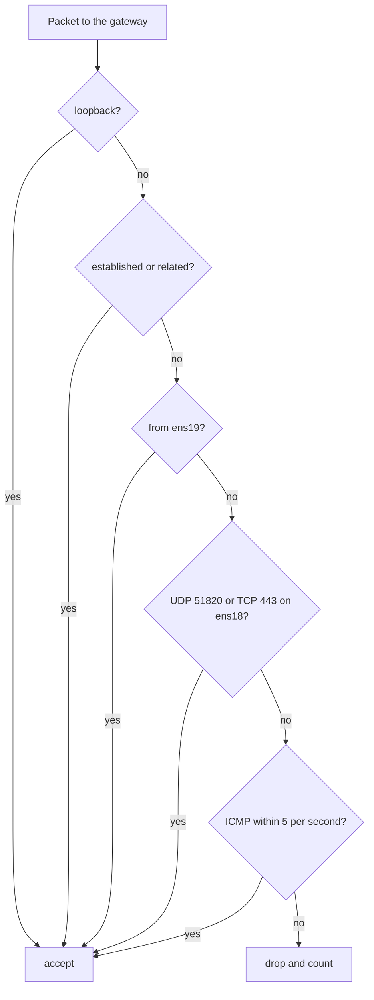

## Introduction

This is part 3 of my series **Owning the Edge**. In [part 1](/blog/replacing-a-black-box-vpn/) I explained why I decided to build my own way into my servers, and in [part 2](/blog/routed-vm-network-proxmox/) I built the routed internal network that the virtual machines use to talk to each other.

Now it is time for the most exposed machine of the whole setup: the VPN gateway, `edge-vpn-01`. It is the only machine with a public IP address, which means every scanner on the internet will find it within minutes. In this post I will go through how I set it up so that there is as little as possible to find.

## The Idea: Minimal Exposure

The gateway does exactly one job: it terminates VPN tunnels and forwards the traffic into the internal network. Everything that is not needed for that job is either not installed or not reachable. In practice that means:

- **two open ports** — UDP 51820 for WireGuard and TCP 443 for the OpenVPN fallback,
- **no public SSH** — SSH listens only on the internal network,
- **one login user** — key-only authentication, no password, no sudo,
- **no root login over the network** — root needs the hypervisor console,
- **a firewall that drops everything** it was not explicitly told to accept.

The VM itself is a minimal Debian installation without a graphical interface and without any service that is not needed.

## Network Interfaces

The gateway has two network cards and, once the VPNs are running, two tunnel interfaces:

| Interface | Network | Role |
| --- | --- | --- |
| `ens18` | `203.0.113.10/25` | Public: VPN listener and internet access |
| `ens19` | `10.60.0.52/24` | Internal: management and routing into the internal network |
| `wg0` | `10.99.0.1/24` | WireGuard tunnel |
| `tun0` | `10.99.1.1/24` | OpenVPN tunnel |

The configuration in `/etc/network/interfaces`:

```nginx
auto ens18
iface ens18 inet static
    address 203.0.113.10/25
    gateway 203.0.113.1

auto ens19
iface ens19 inet static
    address 10.60.0.52/24
    post-up   ip route add 10.61.0.0/24 via 10.60.0.1
    post-down ip route del 10.61.0.0/24 via 10.60.0.1
    post-up   ip route add 10.20.30.0/24 via 10.60.0.1
    post-down ip route del 10.20.30.0/24 via 10.60.0.1
```

The default route goes out of the public interface. The internal interface only gets routes for the networks behind it: the second Proxmox host's network and the old LAN where my services live.

I added the route to the old LAN later than the others, and only because something did not work. VPN clients could reach the internal network but not the services on the LAN. The gateway simply had no route for `10.20.30.0/24`, so it sent that traffic to its default gateway, out of the public interface, where it died at the provider's edge.

## SSH Only on the Inside

SSH is configured in a separate drop-in file, so that the distribution's default `sshd_config` stays untouched:

```nginx
# /etc/ssh/sshd_config.d/50-edge.conf
ListenAddress 10.60.0.52
PasswordAuthentication no
KbdInteractiveAuthentication no
PermitRootLogin no
AllowUsers operator
```

Line by line:

- **`ListenAddress`** — the SSH daemon binds only to the internal address. On the public interface there is nothing listening, so there is nothing to brute-force.
- **`PasswordAuthentication no`** and **`KbdInteractiveAuthentication no`** — only SSH keys are accepted. The second line matters, because keyboard-interactive authentication can otherwise act as a password prompt through the back door.
- **`PermitRootLogin no`** — root cannot log in over SSH at all.
- **`AllowUsers operator`** — exactly one account is allowed to log in.

The `operator` account is not in the `sudo` group. It can log in and look around, but it cannot become root. For anything that needs root, I use the Proxmox console of the VM. This is less convenient, and that is the point: an attacker who somehow gets the `operator` key still does not own the machine.

For key login to work, SSH is strict about permissions: `~/.ssh` must be `700`, `~/.ssh/authorized_keys` must be `600`, and both must belong to the user.

[ Note ] Always validate the SSH configuration with `sshd -t` before restarting the service, and keep a second session or the console open while you do it. I had two typos in this file (`PermiRootLogin` and `Allowusers`), and `sshd -t` is what caught them, not my eyes.

## The Firewall

The firewall is written in nftables. The policy is default-deny: every packet that does not match an explicit rule is dropped. The whole ruleset fits on one screen, which I consider a feature, because I can read all of it at once and know exactly what is allowed.

```nft
#!/usr/sbin/nft -f
flush ruleset

table ip filter {
  chain input {
    type filter hook input priority 0; policy drop;
    iifname "lo" accept
    ct state established,related accept
    iifname "ens19" accept
    iifname "ens18" udp dport 51820 accept
    iifname "ens18" tcp dport 443 accept
    ip protocol icmp limit rate 5/second accept
    counter drop
  }
  chain forward {
    type filter hook forward priority 0; policy drop;
    ct state established,related accept
    iifname "wg0" accept
    iifname "tun0" accept
  }
}

table ip nat {
  chain postrouting {
    type nat hook postrouting priority 100;
    iifname "wg0"  oifname "ens18" masquerade
    iifname "wg0"  oifname "ens19" masquerade
    iifname "tun0" oifname "ens18" masquerade
    iifname "tun0" oifname "ens19" masquerade
  }
}
```

There are three chains, and each one answers one question.

**`input`: what may talk to the gateway itself?** Loopback traffic, replies to connections the gateway opened, everything from the internal network, the two VPN ports on the public interface, and a limited amount of ping. The `counter drop` at the end is not strictly needed, because the policy already drops, but the counter tells me how much traffic is being rejected.



**`forward`: what may pass through the gateway?** Only traffic that comes out of a VPN tunnel, and the replies to it. Nothing that arrives on the public interface can be forwarded into the internal network on its own initiative. This is the rule that makes the VPN the only door.

**`postrouting`: how does tunnel traffic leave?** VPN traffic is masqueraded when it leaves the gateway, both towards the internet and towards the internal network. Because of that, the internal machines see connections coming from the gateway's internal address and do not need routes back to the tunnel networks.

To load the rules and make them persistent:

```bash
nft -f /etc/nftables.conf
systemctl enable --now nftables
```

## Checking from the Outside

The best test of a firewall is to look at it from where an attacker would. From a machine outside my network, a port scan of `203.0.113.10` should show TCP 443 as open and nothing else on TCP. UDP is harder to scan reliably, but WireGuard is quiet by design: it does not answer packets that do not come from a known key, so to a scanner port 51820 looks the same as any other port that the firewall silently drops.

```bash
nmap -Pn -p- 203.0.113.10
```

## Conclusion

None of these measures is advanced on its own. Two open ports, SSH on the inside, one user without sudo and a short default-deny ruleset are things everyone has heard of. The value is in applying all of them together, so that each one covers for the others. If the firewall had a mistake, there would still be no SSH listening on the public interface. If an SSH key leaked, there would still be no root.

In the next post I will set up the primary tunnel, WireGuard, and configure my laptop so that only the traffic for my servers goes through it.
