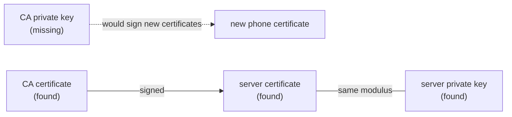

## Introduction

This is part 6 of my series **Owning the Edge**. In the first five posts I described how I built my own VPN gateway, internal network and DNS, starting with [why I replaced the old VPN](/blog/replacing-a-black-box-vpn/) and ending with [two-tier DNS](/blog/two-tier-dns-coredns-pihole/).

In the first post I admitted to one shortcut: for the OpenVPN fallback tunnel I reused the certificates from the old, provider-managed server, so that I would not have to issue new ones right away. This post is about the day that shortcut stopped working. I wanted to add my phone to the OpenVPN tunnel. A new client needs a new certificate, a new certificate must be signed by the certificate authority (CA), and signing needs the CA's private key. I went looking for that key and found out that it did not exist anymore.

## Why the CA Key Matters

OpenVPN, like most TLS-based systems, uses a public key infrastructure (PKI). Every client and the server have a certificate, and every certificate is signed by the CA. When a client connects, the server checks that the client's certificate was signed by its CA, and the client does the same with the server's certificate.

The CA's private key is the single point of failure of this whole identity system:

- **Lost CA key** — you can still verify existing certificates, but you can never issue a new one. No new devices, no new users, no replacement certificates.
- **Stolen CA key** — an attacker can create a valid certificate for any identity they want.
- **Expired CA** — the same as lost, only scheduled in advance.

A PKI that you cannot extend is a PKI that you do not control.

## The Search

I started with the obvious places on the old server. Tools like easy-rsa keep their files in a known directory structure, so if a PKI had ever been built there, it should still be on disk:

```bash
# Any easy-rsa directories?
ls -d /root/easy-rsa /etc/openvpn/easy-rsa /usr/share/easy-rsa 2>/dev/null
# -> only the files of the installed package, no PKI was ever built here

# Any client profiles lying around?
ls /root/*.ovpn /etc/openvpn/*.ovpn 2>/dev/null
# -> nothing

# A CA key anywhere on the filesystem?
find / -name 'ca.key' 2>/dev/null
# -> only the example keys that ship with the OpenVPN documentation
```

No PKI directory, no stray key files. Everything that was real lived in one single file: the server configuration.

## Inline Blocks

OpenVPN allows certificates and keys to be written directly into the configuration file, between tags like `<ca>` and `</ca>`, instead of being referenced as separate files. The old server's configuration did exactly that:

```text
81:  <ca>           <- CA certificate
123: <cert>         <- server certificate
167: <key>          <- one private key
225: <dh>           <- Diffie-Hellman parameters
401: ###<tls-auth>  <- commented out
```

Next to it was a backup of the same file with an `.org` extension, the untouched original from when the server was set up. Comparing the two showed the full history of the server in two changes: the DNS servers pushed to the clients, and the `tls-auth` block, which had been active in the original and was later commented out. That second change means that for years the control channel of this VPN ran without the extra authentication layer that `tls-auth` provides. I will come back to that in a later post.

Both files contained exactly one `<key>` block each, which I confirmed with `grep -c '<key>'`. So there was one private key. The question was: whose key is it?

## The Decisive Test

I extracted the blocks into separate files:

```bash
awk '/<ca>/{f=1;next}/<\/ca>/{f=0}f' server.conf > ca.crt
awk '/<cert>/{f=1;next}/<\/cert>/{f=0}f' server.conf > server.crt
awk '/<key>/{f=1;next}/<\/key>/{f=0}f' server.conf > server.key
```

First, does the server certificate really come from this CA?

```bash
$ openssl verify -CAfile ca.crt server.crt
server.crt: OK
```

It does. Now the important part. A certificate contains a public key, and the private key file contains the matching private key. For RSA keys, both share the same modulus, a very large number. If two moduli are equal, the certificate and the key belong to the same key pair. Comparing the large numbers directly is impractical, so I compare their hashes:

```bash
$ openssl x509 -in server.crt -noout -modulus | openssl md5
MD5(stdin)= 3f9c2a7be1d04c58a6e27b91d0c4f5e2

$ openssl rsa -in server.key -noout -modulus | openssl md5
MD5(stdin)= 3f9c2a7be1d04c58a6e27b91d0c4f5e2

$ openssl x509 -in ca.crt -noout -modulus | openssl md5
MD5(stdin)= b81e44d07a9f3c26e5d1a8c03f7b9e14
```

The server certificate and the key have the same modulus, so the one private key in the file is the **server's** key. The CA certificate has a different modulus, which means it belongs to a different key pair, and the private half of that pair was nowhere: not in any directory, not in either configuration file.



For keys that are not RSA (for example elliptic curve keys), the modulus option does not apply. A check that works for every key type is to compare the public keys directly:

```bash
openssl x509 -in server.crt -noout -pubkey | sha256sum
openssl pkey -in server.key -pubout | sha256sum
```

## The Conclusion

The result was clear:

- The old chain could still **verify** existing certificates, because the CA certificate was there.
- It could never **sign** a new certificate, because the CA's private key was gone.
- My phone could not get a certificate from this CA, and neither could any future device.

Somewhere in the past seven years, the CA's private key had been created, used to sign the server and client certificates, and then lost or deliberately not kept. There was no way to recover it. Every way forward that used the old PKI was a dead end.

## Lessons

The most useful thing from this episode is the check itself. When I take over any TLS or VPN setup, comparing the moduli (or the public keys) is now the first thing I do. It takes thirty seconds and answers two questions definitively: do the certificates and keys I have actually belong together, and do I have the CA key at all.

The second lesson is about timing. I found this problem while trying to add a phone, which is a small, everyday task. If I had found it in the middle of an incident, for example while revoking a stolen laptop's certificate, it would have been much worse. It is better to audit an inherited PKI before you need it.

## Conclusion

There was only one way forward: build a completely new PKI, with a new CA whose private key I own, and move every client to it. In the next post I will go through that rebuild with easy-rsa, the validity periods I chose, and how a 20 KB configuration file with everything inlined turned into five clean lines.
