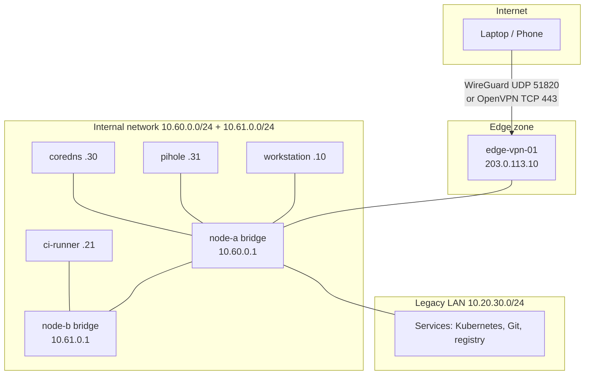

## Introduction

A few weeks ago the VPN that I use to reach my servers stopped working. Not slowly, not intermittently, but completely. The servers themselves were fine, the virtual machines were running, but the only door into them was closed and I could not see why.

This is the first post in a series that I call **Owning the Edge**. In it I will go through how I replaced that broken door with one that I built and control myself: a VPN gateway, a routed internal network between my virtual machines, and a small DNS setup. In this first post I will explain the problem, the reasoning behind replacing rather than repairing, and the overall architecture. The following posts go into each part in detail, with the configuration files and the mistakes I made along the way.

## The Setup

My infrastructure is not big. It is a two-node Proxmox cluster rented from a hosting provider, with a handful of virtual machines on it: a development workstation, a CI runner, a Git server, a container registry and a small Kubernetes cluster. All of them sit on a private LAN (`10.20.30.0/24`) that is not reachable from the internet.

The way in was an OpenVPN server running on a VM that was originally set up and managed by the provider, years ago. The provider's firewall forwarded a TCP port to it and I had a client profile on my laptop. It worked for a long time, so I never had a reason to look inside it.

## The Problem

When it stopped working, it turned out that three separate things were wrong at the same time:

1. **The client profile no longer parsed.** My OpenVPN 2 client refused the configuration file, because it contained standalone `--` separator lines between options. Newer versions of the client reject them as unrecognized arguments.
2. **The server was not running at all.** With the modern `openvpn3` client the connection got further, but it hung forever at "Client connecting". When I finally got a shell on the server, the systemd unit for OpenVPN turned out to be a oneshot stub that executed `/bin/true`, and the OpenVPN binary itself could not start because a library was missing: `libssl.so.3: cannot open shared object file`.
3. **Nobody knew why port 444.** The client profile pointed at TCP port 444. There was no documentation explaining that number. The forward lived in the provider's firewall, which I could not see or change.

Each of these can be fixed on its own. The library can be installed, the separators can be removed, the unit can be rewritten. But together they told me something more important: the only path into my own infrastructure depended on a machine whose internal state nobody fully understood, behind a firewall rule I could not read.

## Repair or Replace?

My first instinct was to repair it, because repairing feels cheaper. I changed my mind for a simple reason: even after fixing all three problems, I would still own nothing. The next time something broke, I would again be debugging a black box.

The provider had given me a spare public IP address, and a new VM costs almost nothing on a cluster that already exists. So I decided to build a new entry point from scratch, next to the old one, and only retire the old one once the new one was proven.

I wrote down four principles before touching anything, and I kept coming back to them during the whole build:

- **Self-ownership** — every configuration file, every key pair and every firewall rule lives on a machine that I control directly. No firewall rules at the provider, no undocumented port forwards.
- **Defense in depth** — the new gateway exposes exactly two ports to the internet. SSH listens only on the internal network. The login account cannot use sudo, and root access requires the hypervisor console.
- **Two tunnels** — WireGuard as the primary tunnel, because it is fast and simple, and OpenVPN on TCP port 443 as a fallback for networks that block UDP or only let HTTPS-looking traffic through (hotel and conference Wi-Fi are good at this).
- **Provider independence** — the virtual machines should talk to each other over a network that I route myself, instead of going through the provider's routing VM.

## The Architecture

The result has three zones: the internet-facing edge, a routed internal network that spans both Proxmox hosts, and the existing LAN where the services live.

The components are:

- **`edge-vpn-01`** — a new, minimal Debian VM with one public and one internal network interface. It runs WireGuard and OpenVPN and a default-deny firewall, and nothing else.
- **The internal network** — two `/24` networks, one per Proxmox host, routed between the hosts over the link that already connects them. Every VM gets a stable address that has nothing to do with the provider.
- **CoreDNS** — answers for my internal domain names.
- **Pi-hole** — the resolver that my laptop and phone actually use. It blocks ads and trackers and forwards everything else to CoreDNS.

[ Note ] All names, domains and IP addresses in this series are made up or taken from the ranges reserved for documentation. The structure and the configuration are real.

For the OpenVPN fallback I took a shortcut at first: I reused the certificates from the old server, so that I would not have to issue new ones for every client right away. That shortcut came back to bite me later, and it will get its own post.

## Security in Layers

I tried to build every layer so that it is secure on its own, and so that breaking one layer does not automatically give access to the next one:

- **The edge node** — two open ports, a firewall that drops everything else, SSH only on the internal interface, key-only login, one user without sudo.
- **The internal network** — no VM in it has a default route to the internet, and nothing on the public IP is forwarded to an internal address. The VPN is the only way in.
- **The tunnel** — every WireGuard peer has its own key pair, and the server's private key never leaves the server.
- **DNS** — my internal names are answered by my own resolver and never leak to public resolvers.

## What Comes Next

The whole build took about twenty-four hours of focused work, and a good part of that time went into bugs. In the next posts I will go through the pieces one by one:

- the routed internal network between the two Proxmox hosts,
- hardening the gateway with SSH restrictions and nftables,
- the WireGuard split tunnel on my laptop,
- the two-tier DNS with CoreDNS and Pi-hole.

## Conclusion

The most useful thing I took from this is not technical. A port forward I could not see, a service I could not restart and a firewall I could not read were not really infrastructure, they were a dependency. A spare IP address and one small VM were cheap. Not understanding my own way in was what was expensive.
