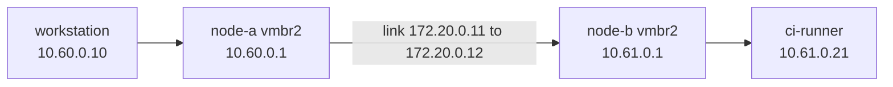

## Introduction

This is part 2 of my series **Owning the Edge**. In [part 1](/blog/replacing-a-black-box-vpn/) I explained why I replaced the broken, provider-managed VPN into my servers with infrastructure that I build and control myself. Before the new VPN gateway could exist, it needed something to connect to, so the first real piece of work was the internal network.

In this post I will go through how I built a routed network for my virtual machines across two Proxmox hosts, how I checked that it really works the way I think it does, and one routing mistake that cost me more time than it should have.

## The Problem

Until now all my VMs sat on one flat network, and traffic between them went through a routing VM that the hosting provider manages. That has two downsides. First, it is another black box: if that VM misbehaves, my machines cannot talk to each other. Second, the addresses on that network belong to the provider's plan, not to mine.

What I wanted instead was simple:

- every VM gets a stable address that I choose,
- VMs on both hosts can reach each other without going through anything the provider manages,
- VMs have **no** direct internet access unless I explicitly allow it.

## The Design

Each Proxmox host gets its own `/24` network on a new bridge called `vmbr2`. The two hosts are already connected to each other over a private link (`172.20.0.0/16`), so I use that link to route between the two networks with static routes.



| Host | Bridge | Network | Address on the host-to-host link |
| --- | --- | --- | --- |
| node-a | `vmbr2` | `10.60.0.0/24` | `172.20.0.11` |
| node-b | `vmbr2` | `10.61.0.0/24` | `172.20.0.12` |

The topology is static: exactly two networks and exactly one path between them. A dynamic routing protocol would add moving parts without solving any problem I have, so two static routes are enough.

### Addressing convention

I did not want DHCP on this network, but I also did not want to keep a spreadsheet of addresses. So the address of a VM is derived from its Proxmox VMID: I take the first and the last digit of the VMID and use them as the last octet.

- VM `300` (CoreDNS) becomes `10.60.0.30`
- VM `110` (workstation) becomes `10.60.0.10`
- VM `502` (the VPN gateway) becomes `10.60.0.52`, not `10.60.0.502`, which would not even be a valid address

The third octet tells you which host the VM lives on, `60` for node-a and `61` for node-b. Two VMs could collide in theory (`502` and `512` would both become `.52`), but with the number of VMs I have it is easy to avoid when choosing a VMID.

## Host Configuration

The bridge is created in `/etc/network/interfaces` on each host. The important line is `bridge-ports none`: the bridge is not attached to any physical network card, so it only carries traffic between the VMs on that host and the host itself.

**node-a:**

```nginx
auto vmbr2
iface vmbr2 inet static
    address 10.60.0.1/24
    bridge-ports none
    bridge-stp off
    bridge-fd 0
    post-up   ip route add 10.61.0.0/24 via 172.20.0.12
    post-down ip route del 10.61.0.0/24 via 172.20.0.12
    post-up   iptables -t nat -A POSTROUTING -s 10.60.0.0/24 -o vmbr0 -j MASQUERADE
    post-up   iptables -t nat -A POSTROUTING -s 10.61.0.0/24 -o vmbr0 -j MASQUERADE
    post-down iptables -t nat -D POSTROUTING -s 10.60.0.0/24 -o vmbr0 -j MASQUERADE
    post-down iptables -t nat -D POSTROUTING -s 10.61.0.0/24 -o vmbr0 -j MASQUERADE
```

**node-b:**

```nginx
auto vmbr2
iface vmbr2 inet static
    address 10.61.0.1/24
    bridge-ports none
    bridge-stp off
    bridge-fd 0
    post-up   ip route add 10.60.0.0/24 via 172.20.0.11
    post-down ip route del 10.60.0.0/24 via 172.20.0.11
```

Both hosts also need IP forwarding enabled, otherwise they will not pass packets between their interfaces:

```bash
echo 'net.ipv4.ip_forward = 1' > /etc/sysctl.d/99-forwarding.conf
sysctl --system
```

The `post-up` and `post-down` hooks make the routes part of the interface itself, so they come back after a reboot without a separate script.

[ Note ] `bridge-ports none` isolates the VMs from the physical network, but it does not isolate them from each other. All VMs on the same bridge share one layer 2 segment, exactly like computers plugged into the same switch. If you need VMs on the same host to be separated from each other, you need firewall rules or separate bridges.

## Checking That It Works

After the configuration was in place, I pinged across the two networks in both directions:

```text
workstation (10.60.0.10) -> ping 10.61.0.21 : ttl=62, ~0.7 ms
ci-runner   (10.61.0.21) -> ping 10.60.0.10 : ttl=62
```

The ping itself only says that the packets arrive. The TTL says how they got there. Linux sends packets with a TTL of 64, and every router on the way decreases it by one. A TTL of 62 means the packet crossed exactly two routers: node-a and node-b. That is exactly what the diagram above says should happen. I like checks like this one, because they confirm the design instead of just confirming that "something works".

## NAT for Outbound Internet

By design, VMs on the internal network have no default route to the internet. Some of them still need outbound access, for example Pi-hole to download its block lists, or the CI runner to pull container images. For those, node-a masquerades traffic from both internal networks out of its main interface `vmbr0` (the `iptables` lines in the node-a configuration above).

There is deliberately no rule in the other direction. Nothing on the internet can open a connection to an internal address, and the only way in from outside is the VPN, which will be the subject of the next posts.

## The Asymmetric Routing Trap

Early in the build one VM had a network card on the internal network but its default gateway on the old network. Pings from node-a to the VM's internal address simply did not come back.

The reason was asymmetric routing. The request arrived on the internal interface, but the VM sent its reply through its default route, out of the other interface, towards the provider's network. The reply came from the wrong interface with the wrong source path, and somewhere along the way it was dropped. Nothing logged an error. Packets just disappeared.

The fix is to be strict about which interface owns the default route. The internal interface gets only the routes it needs, and it is told explicitly never to become the default route.

## VM Template with NetworkManager

My VMs use NetworkManager, so every VM that joins the internal network gets the same two commands:

```bash
# Make sure the main connection is bound to the first network card
nmcli con mod "Wired connection 1" ifname ens18
nmcli con up "Wired connection 1"

# Add the internal network on the second card
nmcli con add type ethernet ifname ens19 con-name clusternet \
  ipv4.method manual ipv4.addresses 10.60.0.XX/24 \
  ipv4.routes "10.61.0.0/24 10.60.0.1" \
  ipv4.never-default yes
nmcli con up clusternet
```

`ipv4.never-default yes` is the important option. Without it, NetworkManager may install a second default route on `ens19`, which competes with the real one on `ens18`, and you are back to the asymmetric routing problem from the previous section. The first command exists because of another bug: on VMs cloned from a template, "Wired connection 1" had attached itself to the new network card instead of the old one.

## Migrating the VMs

Every VM followed the same steps: add a second network card on `vmbr2`, give it an address from the VMID, configure it with the template above, ping in both directions, and only then (optionally) remove the old network card.

| VM | VMID | Host | Internal address | Status |
| --- | --- | --- | --- | --- |
| edge-vpn-01 | 502 | node-a | `10.60.0.52` | new, internal from the start |
| workstation | 110 | node-a | `10.60.0.10` | migrated, still on both networks |
| ci-runner | 201 | node-b | `10.61.0.21` | migrated |
| coredns | 300 | node-a | `10.60.0.30` | new, internal from the start |
| pihole | 301 | node-a | `10.60.0.31` | new, internal from the start |

The remaining service VMs (Git, the registry and the Kubernetes nodes) will be moved one by one with the same template. For Kubernetes I want to be careful, because the nodes know each other by IP address.

## Conclusion

Nothing in this post is exotic: a bridge without ports, two static routes, one NAT rule and one NetworkManager option. Most of the work was being consistent about these simple pieces on every host and every VM. And when something did not work, the TTL value and a look at which interface replies leave from told me more than any amount of guessing.

In the next post I will build the VPN gateway itself on top of this network, and lock it down as far as I reasonably could.
