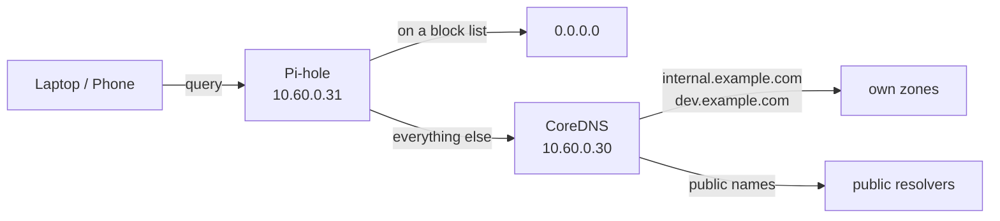

## Introduction

This is part 5 of my series **Owning the Edge**, and the last one about the initial build. In the previous posts I [replaced my old VPN](/blog/replacing-a-black-box-vpn/), built a [routed internal network](/blog/routed-vm-network-proxmox/), [locked down the gateway](/blog/hardening-a-vpn-gateway/) and set up a [WireGuard split tunnel](/blog/wireguard-split-tunnel-networkmanager/) on my laptop.

At the end of the last post I mentioned that both of my first problems with the tunnel were caused by DNS. DNS is one of those things that is invisible when it works and confusing when it does not, so I wanted my own setup to be simple to reason about. In this post I will explain why I ended up with two DNS servers instead of one, and how they are configured.

## Why Two Tiers

A DNS server can play two very different roles:

- **Authority** — it is the source of truth for some names. For example, "`registry.internal.example.com` is `10.20.30.40`".
- **Resolver** — it answers any question a client asks, either from its own data, from a cache, or by asking other servers.

It is tempting to put both roles into one server. I decided to keep them apart:

- **CoreDNS** (VM 300, `10.60.0.30`) is the authority for my internal names. Its configuration changes only when my infrastructure changes.
- **Pi-hole** (VM 301, `10.60.0.31`) is the resolver that my laptop and phone actually talk to. It blocks ads and trackers, shows statistics, and forwards everything it does not block to CoreDNS.

The benefit is that I can experiment with Pi-hole (block lists, allow lists, updates) without any risk of breaking the names that my servers depend on. If Pi-hole is down or misconfigured, the servers keep resolving each other through CoreDNS. The filtering layer is separate from the layer that the infrastructure needs.

## The DNS Chain



Every question from a client goes to Pi-hole first. If the name is on a block list, Pi-hole answers with `0.0.0.0` and the question goes nowhere else. Otherwise it goes to CoreDNS, which either answers from its own zones or forwards the question to public resolvers.

## CoreDNS: The Authority

CoreDNS answers for two zones:

- **`internal.example.com`** — names for my servers and services, for example `registry.internal.example.com`.
- **`*.dev.example.com`** — a wildcard that points every name under `dev.example.com` to the reverse proxy of my development environment. A new development service gets a name without any change in DNS.

A minimal Corefile for this setup looks like this:

```text
internal.example.com {
    file /etc/coredns/db.internal.example.com
    errors
}

dev.example.com {
    template IN A {
        answer "{{ .Name }} 60 IN A 10.20.30.60"
    }
    errors
}

. {
    forward . 1.1.1.1 8.8.8.8
    cache 300
    errors
}
```

The first block serves names from a zone file, the second answers every name under `dev.example.com` with the address of the reverse proxy, and the last block forwards everything else to public resolvers and caches the answers.

Checking it from a machine on the internal network:

```bash
$ dig @10.60.0.30 registry.internal.example.com +short
10.20.30.40
```

## Pi-hole: The Filtering Resolver

Pi-hole runs in Docker on its own small VM. I bind its ports only to the VM's internal address, so it is never reachable on any other interface:

```bash
docker run -d --name pihole --restart unless-stopped \
  -e TZ="UTC" \
  -v ~/pihole/etc-pihole:/etc/pihole \
  -v ~/pihole/etc-dnsmasq.d:/etc/dnsmasq.d \
  -p 10.60.0.31:53:53/tcp -p 10.60.0.31:53:53/udp \
  -p 10.60.0.31:80:80 \
  --cap-add NET_ADMIN \
  pihole/pihole:latest
```

The two volumes keep the configuration and the block lists outside the container, so updating Pi-hole means pulling a new image and recreating the container without losing anything.

One thing I had forgotten: the internal network has no internet access by design. Pi-hole could not pull its image or download its block lists until I added the NAT rules on node-a that I described in [part 2](/blog/routed-vm-network-proxmox/). It is a good example of a security decision (no internet by default) that you have to remember when something unrelated breaks.

### Settings that matter

Most of the Pi-hole configuration is done in its web interface. Three settings are important for this setup:

- **CoreDNS as the only upstream.** I unchecked all the public resolvers (Google, Cloudflare, Quad9) and added `10.60.0.30` as a custom upstream. If Pi-hole had a public resolver as a second upstream, some questions for my internal names would go to that public resolver. They would fail, and they would also tell a third party which internal names I use.
- **Never forward reverse lookups for private IP ranges.** Pi-hole kept complaining that its upstream "refused to do a recursive query". The reason was reverse lookups (PTR) for `10.x` addresses, which it forwarded to CoreDNS, and which CoreDNS has no zone for. With this option Pi-hole answers them itself.
- **Never forward non-FQDNs.** Bare host names like `registry` are never sent upstream.

## Testing the Block Lists

The easiest test is to ask for a domain that is on every advertising block list:

```bash
$ dig @10.60.0.31 doubleclick.net
doubleclick.net.  2  IN  A  0.0.0.0
; EDE: 15 (Blocked): (gravity)
```

The answer `0.0.0.0` together with the extended DNS error code `15 (Blocked)` confirms that Pi-hole blocked the name from its "gravity" database, which is what Pi-hole calls its combined block lists.

## Using It from My Devices

Since the last post I have added my phone as a second WireGuard peer. On the phone I use a full tunnel, so all of its traffic goes through the gateway and its DNS server is set to Pi-hole. On the laptop I keep the split tunnel and point the `edge-vpn` connection at Pi-hole as well:

```bash
nmcli connection modify edge-vpn ipv4.dns 10.60.0.31
```

For the OpenVPN fallback, the server pushes the DNS server to the clients with a `push "dhcp-option DNS ..."` line.

[ Note ] Because the gateway masquerades all tunnel traffic, Pi-hole sees every VPN client as the gateway's own address `10.60.0.52`. The blocking works the same, but the per-device statistics show one client instead of several. To see each device separately, the gateway would have to stop masquerading towards the internal network, and the internal network would need a route back to the tunnel networks. For now I accept the single entry.

## Conclusion

With the DNS in place, the initial build is complete: a gateway with two tunnels, an internal network that I route myself, and a DNS setup where the names my servers depend on are separate from the filtering my devices use. Internal names never leave my network, and advertising is blocked before a connection is even made.

In the next post the story continues, but not in the way I planned. When I tried to add my phone to the OpenVPN fallback tunnel, I found out that the certificates I had reused from the old server had a problem I could not fix.
